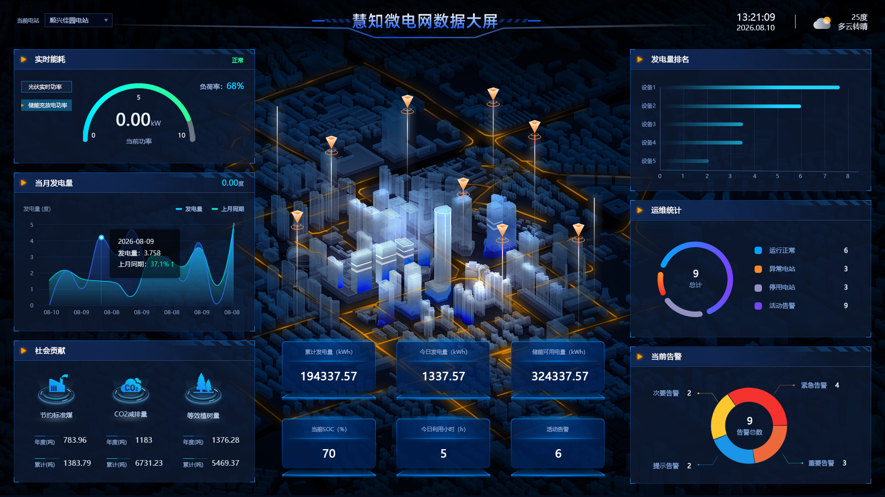
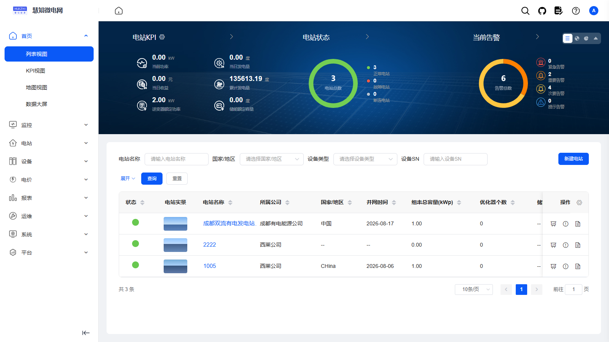
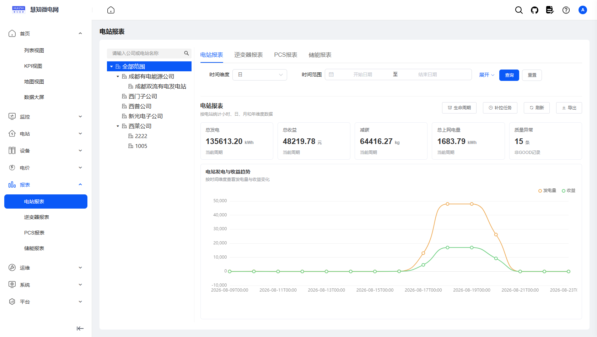
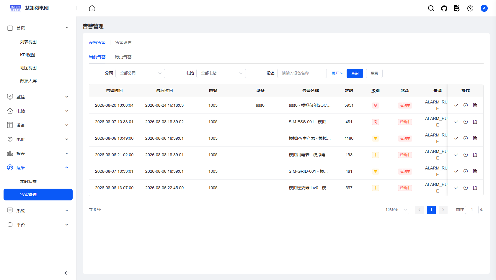
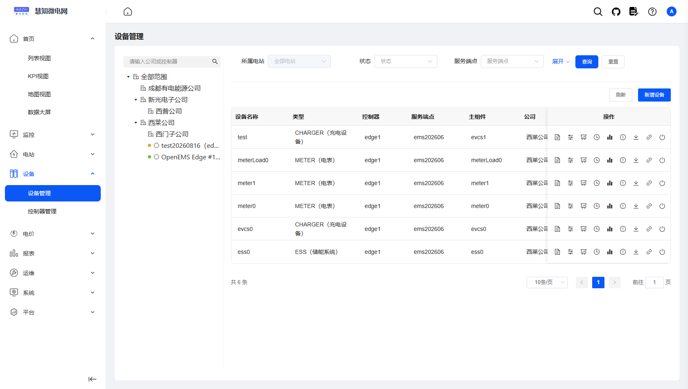

# GOEMS 能源管理系统（管理后台前端）

当前版本：3.0.8

[🔥 GOEMS管理后台前端源码](https://github.com/roinli/GOEMS-admin)（当前）

[🔥 GOEMS平台微服务源码](https://github.com/roinli/GOEMS-cloud)

[🔥 更新日志](https://blog.csdn.net/Roinli?spm=1000.2115.3001.5343)

> 基于 Vue 2 + Element UI 的 GOEMS 能源管理云平台（EMS）管理后台前端，配套 GOEMS-cloud 微服务后端。

<p align="center">
    <a href="https://ems-pc.huizhidata.com/login?redirect=%2Fems-home%2Flist">在线体验</a> | <a href="https://ems-doc.huizhidata.com/">帮助文档</a>
</p>

⚡️GOEMS 开源能源管理系统全套源码⚡️；⚡️能源管理系统（EMS）⚡️；⚡️储能光伏运营平台⚡️；⚡️多租户 SaaS 能源云平台⚡️；Spring Cloud Alibaba + MySQL + Redis + Nacos，多租户隔离、企业-电站-设备三级资产管理、设备智能接入、时序采集与远程管控、阈值告警与多渠道通知、多维经营报表与能量流分析、运营管理后台、数据大屏，一站式能源数字化运营解决方案。

GOEMS 基于 MIT 协议发布，代码全开源无加密、可免费商用，适合储能、光伏等能源资产运营方与集成商，快速构建「企业 - 电站 - 设备」三级资产模型的能源管理云平台。

---

## 📖 项目介绍

系统采用 Java + Spring Cloud Alibaba 微服务架构（后端），基于 RuoYi-Cloud 多租户版（witos-platform）二次开发，前后端分离设计清晰。前端通过 GOEMS 设备接入层对接边缘能源设备，实现设备接入、时序采集、远程管控、告警通知与经营分析的完整闭环；原生多租户隔离，可同时服务多个能源运营主体，数据独立、权限隔离。








---

### 核心功能

#### 能源驾驶舱
统一呈现公司、电站、设备、功率、电量、收益、告警与社会贡献数据，支持列表、地图、KPI 与数据大屏多视图切换，一屏掌握整体运营态势。

#### 云边协同
自研边缘控制器与平台云端资源统一编排，支持资源发现、能力快照、离线暂存、上线下发与冲突检测，保障边缘侧断网续传与指令一致性。

#### 多类设备模型
覆盖电表、光伏、储能、PCS、负荷与辅助设备，以统一指标、状态和能力模型对外提供数据，屏蔽异构设备差异。

#### 时序数据底座
原始采样、实时快照与小时/日/月/年分层存储，支持历史追溯、缺口补拉与收益重算，为报表与告警提供可靠数据底座。

#### 实时监控与控制
实时感知功率、SOC、设备状态与采样质量，控制指令下发前完成状态、能力、参数、权限与时效校验，避免误操作。

#### 告警与运维中心
支持告警规则、告警分级、当前告警、历史告警、邮件通知与状态大屏，形成「发现-通知-处置」的运维闭环。

#### 电价与收益
支持分时电价、电站套用、光伏与储能收益、节能收益与社会贡献统计，支撑经营分析与结算决策。

#### 多租户治理
租户、公司、电站、用户、角色、菜单、数据范围与操作审计分层隔离，满足多运营主体 SaaS 化运营。

#### 微服务高扩展
Spring Boot + Spring Cloud Alibaba + Nacos + Gateway + Security + MyBatis-Plus + Redis + ECharts 开箱即用，便于持续二开。

### 系统优势

#### 成熟稳定的微服务架构
后端 Spring Boot + Spring Cloud Alibaba，Nacos 注册与配置中心、网关统一鉴权，模块化拆分清晰。

#### 规范的接口设计
提供标准 RESTful 接口与统一数据结构，Swagger 在线文档，接口复用率高，便于二次开发与第三方系统集成。

#### 多维度经营分析
小时/日/月/年报表与能量流分析，经营数据支持 Excel 导出，助力运营决策。

#### 高效开发支持
内置代码生成器，支持前后端代码一键生成，大幅减少重复工作，提升开发效率。

#### 精细权限控制
基于 Spring Security 实现 RBAC 角色权限控制，可精确到按钮级别，支持租户数据隔离与数据权限范围，保障系统安全。

#### 高可用设计
内置 Redis 缓存、Sentinel 限流熔断、Seata 分布式事务与 XXL-JOB 定时任务，有效削峰解耦，提升系统并发能力与稳定性。

---

## 💻 技术特点（前端）

### 运行环境及框架

1. 前端框架：Vue 2.6 + Vue CLI 4 + Vue Router 3 + Vuex 3
2. UI 组件库：Element UI 2.15
3. 图表可视化：ECharts 5 + echarts-gl（数据大屏）
4. 网络请求：axios（统一封装、请求拦截）
5. 样式：Sass + SVG 雪碧图
6. 构建产物：gzip 压缩（compression-webpack-plugin）
7. 运行条件：Node.js + npm（构建脚本依赖 `--openssl-legacy-provider`，建议 Node 17+）

### 前端代码结构（src/）

```
src/
├── api          后端接口封装
├── assets       静态资源（图标、样式）
├── components   通用组件
├── config       全局配置
├── directive    自定义指令（按钮级权限等）
├── layout       后台布局框架
├── plugins      插件
├── router       路由与动态路由
├── store        Vuex 状态管理
├── utils        工具函数
└── views        页面视图
```

---

## 系统演示

在线演示：https://ems-pc.huizhidata.com/login?redirect=%2Fems-home%2Flist

演示环境权限开放，请勿随意删除数据。本地启动体验见下方「快速开始」，启动后可通过 Swagger 在线查看与调试接口。

<p align="center">
    
</p>

## 📚 项目资料

- 在线文档：https://ems-doc.huizhidata.com/   （使用文档 / 接口文档）
- 后端仓库：https://github.com/roinli/GOEMS-cloud  （后端源码与完整 README）
- Swagger 接口文档：部署后端后访问各服务 `/swagger-ui.html` 在线查看

## 快速开始

环境要求：Node.js + npm。

```bash
# 安装依赖
npm install

# 建议不要直接使用 cnpm 安装依赖，会有各种诡异的 bug。
# 可以通过如下操作解决 npm 下载速度慢的问题
npm install --registry=https://registry.npm.taobao.org

# 启动服务
npm run dev
```

浏览器访问 http://localhost:80


### 发布

```bash
# 构建测试环境
npm run build:stage

# 构建生产环境
npm run build:prod
```

构建产物输出到 `dist/` 目录。

---

## 功能矩阵

| 🔴 能源业务 | 🟠 设备与云边协同 | 🟡 监控告警 | 🟢 经营分析 | 🔵 平台底座 | 🟣 系统设置 | 🟤 第三方对接 |
|---|---|---|---|---|---|---|
| 企业管理 | 云边资源编排 | 实时指标监控 | 小时/日/月/年报表 | 网关路由与鉴权 | 租户管理 | 天气服务 |
| 电站管理 | 资源发现与能力快照 | 历史时序聚合 | 能量流分析 | 认证授权中心 | 租户套餐 | 腾讯地图 |
| 设备管理 | 离线暂存与上线下发 | 告警规则与分级 | 首页经营驾驶舱 | Sentinel 限流熔断 | 用户管理 | 邮件通知 |
| 员工管理 | 多类设备模型 | 当前/历史告警 | 价格策略 | Seata 分布式事务 | 角色权限 | |
| 业务参数配置 | 时序数据同步 | 告警事件闭环 | 光伏/储能收益 | Redis 缓存 | 菜单管理 | |
| 心跳与状态监测 | 远程指令下发（含控制校验） | 邮件通知 | 数据导出 | XXL-JOB 定时任务 | 部门/岗位 | |
| | 设备档案 | 告警通知日志 | 节能收益与社会贡献 | 代码生成器 | 数据字典 | |
| | | | | 文件服务（MinIO） | 通知公告 | |
| | | | | 服务监控 | 操作/登录日志 | |

## 致谢

本项目基于 [RuoYi-Cloud](https://gitee.com/y_project/RuoYi-Cloud) 与 [witos-platform](https://gitee.com/witos/witos-platform) 二次开发，感谢若依开源社区与 witos 开源作者的贡献。

## 反馈与交流

- 项目主页：https://github.com/roinli/GOEMS-admin
- 欢迎通过 GitHub Issues 提交 Bug、交流方案、获取更新动态。

---

© 2026 GOEMS 版权所有 · 开源协议：MIT License